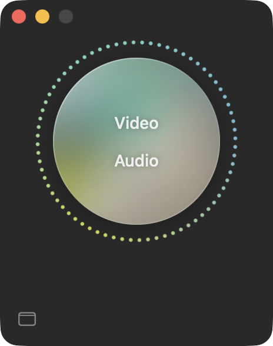

 

 

**Pea** is a tiny all-in-one downloader. Copy a link and the circle lights up; click it, pick *Video* or *Audio* and a quality, and the file lands in Downloads. Drag it straight out of the window to move it where you need it.

- **Video, audio, images and GIFs** from YouTube, Spotify tracks, SoundCloud, TikTok, Instagram, X, Pinterest and [the many other sites yt-dlp supports](https://github.com/yt-dlp/yt-dlp/blob/master/supportedsites.md)
- **Any direct file link** (HTTP/HTTPS) downloads over several connections at once
- **Cover art and metadata** are embedded in the file. Audio as Opus, MP3 or WAV; video is always MP4
- **Menu bar or window**, your choice. No accounts, no tracking, no ads

## Install

| | |
| --- | --- |
| **macOS 14+** | Open the `.dmg` and drag Pea to Applications. It isn't notarised, so the first time, right-click → **Open**. |
| **Windows** | Coming soon. |
| **Linux** | `sudo apt install ./Pea-linux-amd64.deb` |

**Nothing else to install.** [yt-dlp](https://github.com/yt-dlp/yt-dlp) and [ffmpeg](https://ffmpeg.org) are inside, and yt-dlp quietly keeps itself current. Prefer to build it yourself? `./bundle.sh` on macOS, or `swift build -c release` anywhere.

## Please use it responsibly

Pea does not condone piracy. It is a free tool, made to save creators time, for content you own, that is openly licensed, or that you have permission to keep. You're responsible for how you use it. Pea is not affiliated with any of the sites it can read from. See [NOTICE.md](NOTICE.md).

## Credits

Built on [yt-dlp](https://github.com/yt-dlp/yt-dlp) and [FFmpeg](https://ffmpeg.org), inspired by [media_downloader](https://github.com/MSC72m/media_downloader) and [Blip](https://blip.net). Badges by [shieldcn](https://github.com/jal-co/shieldcn). Full list and licences in [NOTICE.md](NOTICE.md).

Free and always will be. If Pea saves you time, you can <a href="https://buymeacoffee.com/aksisonline">buy me a coffee ☕</a>.

MIT © [aksisonline](https://github.com/aksisonline)

