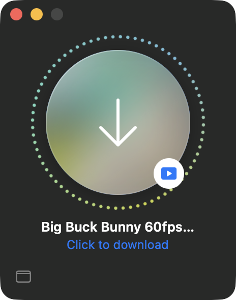
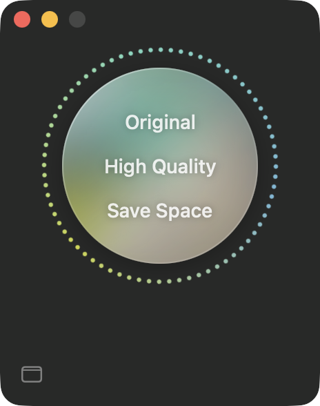
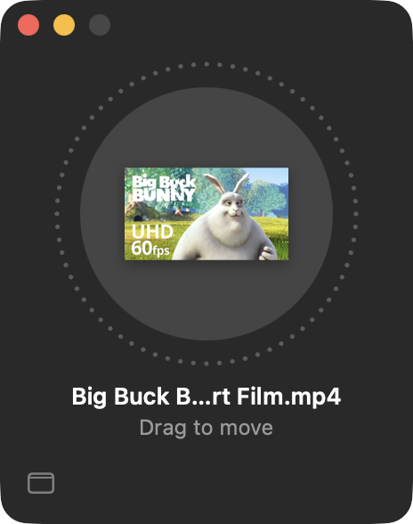

 

# Pea

**Copy a link. Click the circle. Drag the file out.**

A tiny all-in-one downloader for macOS, Windows and Linux.

 

&nbsp;&nbsp;

&nbsp;&nbsp;

 
 

&nbsp;

&nbsp;

&nbsp;

 

<b>1</b> Copy a link &nbsp;·&nbsp; <b>2</b> Pick video or audio &nbsp;·&nbsp; <b>3</b> Pick a quality &nbsp;·&nbsp; <b>4</b> Drag it out

 
 

---

## What it does

Copy a link and the circle lights up. Click it, pick *Video* or *Audio* and a quality, and the file lands in your Downloads. Drag it straight out of the window to **move** it wherever you need it. No buttons, no settings screens, no noise.

 

<table>
<tr>
<td width="50%" valign="top">

### 🎬 Almost anything

Video, audio, images and GIFs from YouTube, Spotify tracks, SoundCloud, TikTok, Instagram, X, Pinterest and [the many other sites yt-dlp supports](https://github.com/yt-dlp/yt-dlp/blob/master/supportedsites.md).

</td>
<td width="50%" valign="top">

### ⚡ Fast direct links

Any plain HTTP/HTTPS file link downloads over several connections at once.

</td>
</tr>
<tr>
<td width="50%" valign="top">

### 🏷️ Tagged for you

Cover art and metadata are embedded in the file. Audio as Opus, MP3 or WAV; video is always MP4.

</td>
<td width="50%" valign="top">

### 🔒 Private and quiet

Lives in the menu bar or a window, your choice. No accounts, no tracking, no ads.

</td>
</tr>
</table>

 

---

## Install

| Platform | How |
| :-- | :-- |
| 🍎&nbsp;**macOS&nbsp;14+** | Open the `.dmg` and drag Pea to Applications. It isn't notarised, so the first time, right-click → **Open**. |
| 🪟&nbsp;**Windows&nbsp;10+** | Unzip anywhere and run `PeaWindows.exe`. |
| 🐧&nbsp;**Linux** | `sudo apt install ./Pea-linux-amd64.deb` |

Pea runs [`yt-dlp`](https://github.com/yt-dlp/yt-dlp) and [`ffmpeg`](https://ffmpeg.org); the first-run screen offers to install them for you.

**Build it yourself:** `./bundle.sh` on macOS, or `swift build -c release` anywhere.

 

---

## Please use it responsibly

Pea does not condone piracy. It is a free tool, made to save creators time, for content you own, that is openly licensed, or that you have permission to keep. You're responsible for how you use it. Pea is not affiliated with any of the sites it can read from. See [NOTICE.md](NOTICE.md).

 

---

## Credits

Built on [yt-dlp](https://github.com/yt-dlp/yt-dlp) and [FFmpeg](https://ffmpeg.org), inspired by [media_downloader](https://github.com/MSC72m/media_downloader) and [Blip](https://blip.net). Badges by [shieldcn](https://github.com/jal-co/shieldcn). Full list and licences in [NOTICE.md](NOTICE.md).

 

Free and always will be. If Pea saves you time, you can <a href="https://buymeacoffee.com/aksisonline">buy me a coffee ☕</a>

MIT © [aksisonline](https://github.com/aksisonline)

